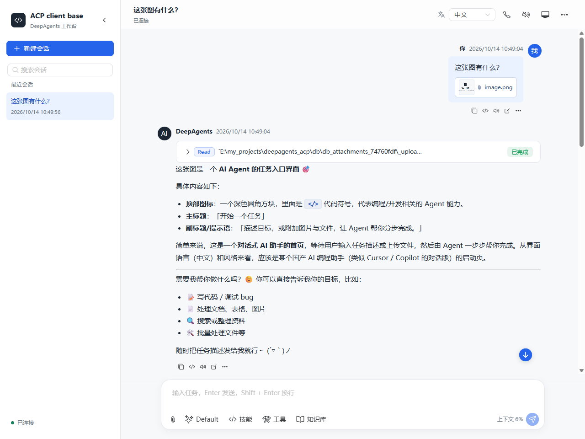
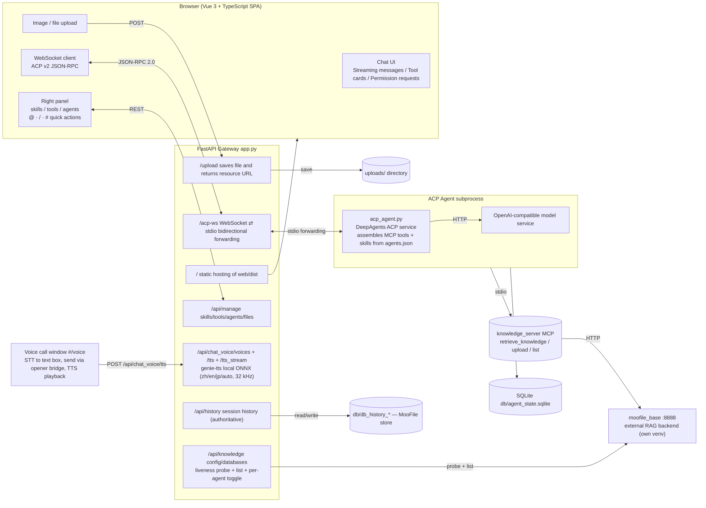

# DeepAgents + ACP + FastAPI Gateway

This project is a runnable ACP (Agent Client Protocol) web integration example: a Vue 3 chat client talks to a DeepAgents agent through a FastAPI gateway over WebSocket, and the agent calls an OpenAI-compatible model service to complete tasks step by step with tool calls.

## Overview

- **Streaming chat**: AI replies stream in real time — text, thought, execution plan and tool-call cards are rendered incrementally; Markdown, code highlight, Mermaid diagrams and sanitized inline HTML are all supported.
- **Tool calls**: each tool card shows parameters / return value in collapsible `json` tabs; permission requests (`session/request_permission`) can be approved, rejected or always-approved.
- **Message actions**: copy (plain text or Markdown), retry (last AI message only), edit (Markdown source editing without re-running), delete via the `...` menu.
- **Conversations**: recent-conversation sidebar with search/filter, rename via context menu, delete with confirmation, and timestamps in `YYYY/MM/DD hh:mm:ss`. History is persisted **backend-authoritatively** in a local MooFile store (`db/db_history_<hash8>/db.bson` via `/api/history`, following the same `db_<name>_<hash8>` directory convention as the moofile_base knowledge bases so all data under `db/` is uniformly organized); the frontend only reads history (forced `GET` on entering a session) and no longer pushes it or relies on `localStorage`. `HISTORY_ROOT` can override the directory (default: auto-discover `db/db_history_*`, create one on first run). Every record is tagged with the moofile_base data model (`recordType: "record"` + `dbId`) so the knowledge-base management UI can browse chat history like any plain table.
- **Skills / tools (MCP) / agents management** (2.0): the right-hand panel manages skills, tools (MCP servers + built-in tools) and agents with per-agent enable/disable written to `.deepagents/agents/agents.json` (`skills[]`, `tools.inner_tools`, `tools.mcp_tools`); enabled MCP tools and skills are assembled into the agent by `acp_agent.py build_agent`. The toolbar agent dropdown picks the current agent (icon + capitalized name, appends `` `@Agent` ``), and a new conversation always resets to `default`.
- **Quick actions**: typing `@`, `/` or `#` as the first character of an empty composer triggers file / skill / tool pickers (backend `/api/manage/files?dir=` supports drilling into subdirectories); a selection is inserted backtick-wrapped as `` `@<path>` `` / `` `/skill` `` / `` `#tool` `` with a trailing space. Backticked inline code is highlighted (white chip in user bubbles, light-blue chip in AI bubbles).
- **Attachments**: upload or paste images/files, inline preview, download on click; context usage (used / `CONTENT_SIZE`) shown as percentage with hover detail.
- **Error handling**: ACP error details are returned to the frontend, displayed as the AI message content plus a red error block; the stop button always recovers to send after failures or disconnects.
- **Multi-language**: UI supports Simplified Chinese / Japanese / English (i18n locale files under `web/src/locales/`).
- **Scheduled tasks**: cron / fixed-interval schedulers run DeepAgents tasks unattended against a moofile-backed store (`db/db_timer_tasks_*`); every run gets a fresh agent session (independent context), the conversation keeps the full run history (appended, AI context trimmed only at send time), and a right-hand panel lists tasks with per-run status (start time + duration).
- **Voice call** (2.0): a top-bar call icon opens a dedicated voice-call window (`#/voice`, dark theme) that stays separate from the chat UI. It captures your speech with the browser Web Speech API (STT), synchronizes the recognized text into the main window's input box, and auto-sends it on pause through a `window.opener` bridge (`chatBridge`) so it runs as a normal session message; when the AI reply finishes, the call window fetches local TTS (`/api/chat_voice/tts`, genie-tts local ONNX in `models/`, in-memory WAV, 32 kHz) and speaks it aloud, then resumes listening. Preset voices are `zh` / `en` / `jp` / `auto`; `auto` splits mixed text by language segment (CJK hanzi → Chinese character `feibi`, kana → Japanese `mika`, Latin → English `thirtyseven`) and concatenates each language's audio with a short gap, so a mixed-language reply is read naturally. Long text is synthesized in one shot (no token-context truncation). Playback mode is chosen by `TTS_MODE` (default `file`, non-streaming full WAV; `stream` uses `/tts_stream` — with genie the whole audio is returned as a single PCM chunk, kept for compatibility). The TTS engine is selected by `TTS_ENGINE`: `genie` (default, local ONNX) · `edge_tts` (Microsoft Edge online voices — MP3 decoded to 24 kHz PCM via PyAV, no local model; configure `EDGE_TTS_VOICE_ZH` / `EDGE_TTS_VOICE_JA` / `EDGE_TTS_VOICE_EN` defaults, optional `EDGE_TTS_RATE` / `EDGE_TTS_VOLUME` / `EDGE_TTS_PITCH` prosody, and `EDGE_TTS_PROXY` for restricted networks) · `sapi` (Windows built-in speech voices via win32com, always available on Windows). With `TTS_FALLBACK=true` (default) a primary-engine failure (e.g. Edge service unreachable) automatically falls back to the Windows SAPI voices, so playback never goes silent; per-language SAPI voice fragments can be pinned with `SAPI_VOICE_ZH` / `SAPI_VOICE_JA` / `SAPI_VOICE_EN`. The main window keeps a reply-speak toggle next to the call icon plus a screen-share toggle (when on, sending a message auto-captures the screen as an image attachment), and message action bars have a speak button for any plain-text message.
- **Knowledge base** (2.0): the right-hand panel adds a *Knowledge* tab backed by the external **moofile_base** project (RAG backend on `:8888`, fully separate repo/venv). The gateway exposes `/api/knowledge/config` (liveness probe + base URL), `/api/knowledge/databases` (vector knowledge-base list with per-agent enabled flag) and `/api/knowledge/start` (launch moofile_base from the UI when offline); the panel toggle enable/disable is a single source of truth with the tools panel — it adds/removes the `knowledge_server` MCP entry in `agents.json`, and the AI queries the knowledge base through that MCP server's `retrieve_knowledge` tool whenever it is available. When the backend is unreachable its MCP tools are skipped at assembly time (no hanging calls) and the panel shows an offline hint with a start button. The two projects share one `db/` directory (`MOOFILE_DB_DIR` points to this repo's `db`), so knowledge data and chat history live together. `start-all.ps1` / `stop-all.ps1` bring both services up/down in order (8888 → 8000); the moofile_base location is configured via `MOOFILE_BASE_ROOT_DIR` in `.env` (absolute, or relative to this project; default = sibling directory).
- **Local run**: `start.ps1` / `stop.ps1` manage the gateway and agent processes; all runtime knobs are configured via `.env`.

## Screenshot



The screenshot shows the main chat interface in action:

- **Left sidebar** — the recent-conversation list with search, rename (context menu) and delete (centered confirmation dialog). Sessions are persisted backend-authoritatively in the local MooFile store (`db/db_history_<hash8>/db.bson`), so they survive reloads and are browsable from the knowledge-base management UI.
- **Chat area** — the user asked "这张图有什么？" with an image attachment. The image was uploaded through the **unified attachment store** (`db/db_attachments_<hash8>/`, served via `/api/attachments/{file_id}`): the message only carries a lightweight `[图片: <file_id>]` placeholder plus the local absolute path, so the agent's `Read` tool card can open the file directly (see the resolved path in the card) without the model ever receiving raw pixels in the prompt. Attachments are cascade-deleted when their message/session is removed.
- **Tool-call cards** — each step shows the tool name, the resolved parameters (here: the attachment's absolute path) and its status (`已完成`); parameters/return values expand in collapsible `json` tabs.
- **Bottom composer** — agent dropdown, skills / tools / knowledge-base pickers, context usage (`上下文 6%`) and the connection indicator (`已连接`).

## Architecture



- **ACP layer**: Uses `deepagents-acp` and `agent-client-protocol` to automatically handle protocol messages such as `session/update` and `session/request_permission`, without requiring manual JSON-RPC handling.
- **Gateway layer**: `app.py` handles bidirectional `WebSocket ⇄ stdio` forwarding and file uploads, without parsing business logic.
- **Frontend**: `web/` is a Vue 3 + TypeScript SPA (Vite build, Naive UI) that implements the ACP v2 client; its build output (`web/dist`) is served by the gateway at the root path `/`. `static/index.html` is kept only as a legacy demo page.

## Project structure

```text
./
├─ app.py                # FastAPI gateway (/upload + /acp-ws + /api/manage + /api/history + /api/chat_voice + /api/config, serves web/dist at /)
├─ api/
│  ├─ chat_voice/        # Voice synthesis sub-router (voices / config / tts / tts_stream; genie-tts / edge_tts / sapi)
│  ├─ history.py         # Session history sub-router (GET/PUT/DELETE against db/db_history_*/db.bson MooFile store)
│  ├─ knowledge.py       # Knowledge-base gateway sub-router (/api/knowledge; probes + lists moofile_base, toggles the MCP entry)
│  └─ manage/manager.py  # Skills / tools (MCP) / agents / built-in tools / file-picker sub-router (/api/manage)
├─ acp_agent.py          # DeepAgents ACP agent (stdio service, assembles MCP tools + skills from agents.json)
├─ start-all.ps1         # Start both systems: moofile_base (:8888) then this gateway (:8000)
├─ stop-all.ps1          # Stop both systems (moofile_base first, then this gateway)
├─ utils/
│  ├─ model_util.py      # Model initialization configuration (OpenAI-compatible API)
│  ├─ moofile_util.py    # MooFile wrapper (plain collections + vector collections, used by db/history)
│  ├─ mcp_loader.py      # agents.json → MCP tool assembly + client lifecycle
│  └─ skill_loader.py    # agents.json → per-agent skill enable-set (.deepagents/skills/.enabled/<agent>)
├─ .deepagents/          # Local agent-config home (git-tracked)
│  ├─ agents/            # agents.json (per-agent skills / tools.inner_tools / tools.mcp_tools / subagents) + *.agent.md
│  ├─ skills/            # skill sources + .enabled/<agent>/ materialized enable-set
│  └─ tools/mcp_servers/ # MCP server directories, each with its own manifest.json
├─ web/                  # Vue 3 + TypeScript ACP client (Vite build → web/dist)
│  ├─ src/              # pages: ChatPage / VoiceCallPage; components: ExecutionProcess / ToolCallCard / MarkdownMessage
│  └─ dist/             # build output, served by app.py at the root path
├─ static/
│  └─ index.html        # Legacy demo page (no longer the active frontend)
├─ docs/                # Design documents (DESIGN_ZH.md, DESIGN_2.0_MANAGER.md, UI_DESIGN.md, schedule_task.md, control_update.md)
├─ uploads/              # Uploaded file storage directory (created automatically)
├─ db/                   # SQLite checkpoint (agent_state.sqlite) + MooFile history (db/history), created automatically
├─ start.ps1 / stop.ps1  # Start / stop helper scripts (stop kills the process tree)
├─ .env                  # Application configuration (HOST/PORT/model endpoint/TTS/DB_ROOT/UPLOAD_ROOT/CONTENT_SIZE)
├─ requirements.txt
├─ LICENSE
├─ README.md
├─ README_ZH.md
├─ README_JA.md
└─ .venv/                # Optional local virtual environment
```

## Current implementation details

The actual entry point of this project is `app.py`, not the old `gateway.py` shown in earlier documentation:

- `app.py` starts the FastAPI service.
- `@app.post("/upload")` accepts uploaded files, saves them under `uploads/`, and returns:
  - `uri`: accessible HTTP URL
  - `name`: filename
  - `mimeType`: MIME type
- `@app.websocket("/acp-ws")` creates an independent `acp_agent.py` subprocess for each WebSocket connection and forwards traffic in both directions.
- `acp_agent.py` uses `create_deep_agent(...)` and `interrupt_on` to trigger permission approval; its `build_agent` reads `.deepagents/agents/agents.json` for the current agent and assembles enabled skills and MCP tools (`mcp_<server>_<tool>`) plus recursive `subagents`.
- `/api/manage` (skills / tools / agents / built-in tools / file picker), `/api/history` (authoritative session history in `db/history` MooFile store) and `/api/chat_voice` (TTS) are mounted as sub-routers.

## Quick start

### 1) Create a virtual environment and install dependencies

```powershell
python -m venv .venv
.\.venv\Scripts\pip install -r requirements.txt
```

### 2) Configure environment variables

A `.env` file is included in the project. Example configuration:

```env
# [Common Settings]
PYTHONIOENCODING=utf-8
APP_ENV=pro

MODEL_PROVIDER=openai

TAVILY_API_KEY=-
TIMEOUT=300
MAX_RETRY=2

# [AI settings]
API_KEY=-
ENDPOINT=http://192.168.3.28:8088
MODEL_NAME=qwen3.8-9b
TEMPERATURE=0.8
TOP_P=
MAX_TOKENS=10240
```

Notes:
- `ENDPOINT` is the OpenAI-compatible API base URL.
- `API_KEY` is the access key for the model service.
- `APP_HOST` / `APP_PORT` control FastAPI listening settings.
- `CONTENT_SIZE` is the context window size (tokens), used by the frontend to show the context usage percentage (served via `/api/config`).
- `UPLOAD_ROOT` is the upload storage root (relative to project root or absolute, defaults to `uploads/`); this directory is ignored by git.

If you are connecting directly to the official OpenAI API, configure those values in the same way according to your environment.

### 3) Start the gateway

```powershell
.\.venv\Scripts\python app.py
```

Default listening address:
- `http://127.0.0.1:8000`

### 4) Open the frontend page

```text
http://127.0.0.1:8000/
```

The root path serves the built Vue SPA (`web/dist`).

## Scheduled tasks

Timer tasks run DeepAgents agents on a schedule and record every run into a regular conversation:

- **Schedules**: a cron expression or a fixed interval in minutes. The cron input is validated client-side (illegal expressions are rejected on save); an AI-generated natural-language explanation, preset chips and a `?` tooltip help with the syntax.
- **Task fields**: name, one-line description, prompt, execution agent, enabled flag. When a run starts, the generated user message looks like:

  ```text
  任务名称：<name>・<type>・<schedule>
  任务描述：<description>

  触发方式：自动触发/手动触发

  执行代理：<agent>

  Prompt：<prompt>
  ```

- **Independent context per run**: each execution spins up a fresh agent session (new UUID `agentSessionId`), so the AI does not remember previous runs; the conversation message history, however, is fully appended and kept, and the AI context is only trimmed at send time.
- **Run history**: a record is persisted as `running` before execution and updated to `success` / `failed` / `cancelled` afterwards; the panel shows start time + duration per run (newest first). A scheduler-wide lock prevents overlapping executions.
- **Frontend**: the left sidebar groups timer conversations under "Scheduled Tasks"; the right panel shows the task list (card title shows the task description), per-task run records and a "Run Now" trigger. Viewing a timer session polls every 5 s silently (history + run records, without re-rendering the viewport); switching away stops the poll. Creating a task auto-switches to its conversation; deleting a task removes its conversation and vice versa (bidirectional cascade).
- **API**: `/api/timers` (create / list / update), `/api/timers/{id}/run` (manual trigger), `/api/timers/{id}` (delete), `/api/timers/explain-cron` (natural-language explanation).

## Frontend interaction flow

### File upload

After selecting an image or file, the frontend sends:

```http
POST /upload
Content-Type: multipart/form-data
```

A typical response is:

```json
{
  "uri": "http://127.0.0.1:8000/uploads/xxx.png",
  "name": "xxx.png",
  "mimeType": "image/png"
}
```

The frontend then adds this resource to the `session/prompt` content list: plain files as a virtual-path text context (e.g. `/uploads/xxx.png`), images as ACP `image` content blocks.

### ACP session flow

The frontend executes the following sequence:

1. `initialize` — establish the ACP connection and negotiate protocol version
2. `session/new` — create a new session on first submission
3. `session/prompt` — send the user's task and optional resources
4. `session/update` — receive ongoing agent status updates
5. `session/request_permission` — show an approval dialog when the agent needs user confirmation

## Session reuse behavior

The frontend supports multi-turn conversation reuse and history restoration:

- First submission: creates a new session automatically
- Subsequent submissions: reuse the current `sessionId` and the agent retains prior memory
- Clicking "New Session": starts a fresh session and discards old memory (and resets the agent to `default`)
- Refreshing the page or entering a session: the UI fetches the display history from the backend via `GET /api/history/{cid}` (authoritative MooFile store `db/history`) and calls `session/load` to replay the agent context from the SQLite checkpoint

Core principle:
- Each WebSocket connection starts a dedicated `acp_agent.py` subprocess
- `AgentServerACP` persists LangGraph checkpoints to `db/agent_state.sqlite` by `sessionId` (`load_sessions=True`)
- The frontend no longer pushes history or writes `localStorage`; display state lives in `db/history` and the ACP context lives in the SQLite checkpoint, linked by `sessionId`
- Repeated `session/prompt` calls on the same connection enable multi-turn interaction; `session/load` restores history across reconnects

## Permission approval mechanism

`acp_agent.py` enables `interrupt_on`, so before risky operations the system triggers an HITL interruption and converts it into ACP `session/request_permission`:

```python
interrupt_on={
    "execute": False,     # shell commands run without approval (always allowed by command type)
    "delete": True,       # delete operations require user approval
}
```

The frontend shows a permission dialog with options:
- Allow
- Reject
- Always allow

Reply payload:

```json
{ "outcome": { "outcome": "selected", "optionId": "approve" } }
```

> The frontend replies using the same message ID to ensure ACP request/response matching.

## Model and tool configuration

Model initialization is done in [utils/model_util.py](utils/model_util.py):

```python
MODEL = init_chat_model(
    MODEL_NAME,
    model_provider=MODEL_PROVIDER,
    base_url=ENDPOINT,
    api_key=API_KEY,
    timeout=TIMEOUT,
    max_retries=MAX_RETRY,
    temperature=TEMPERATURE,
    max_tokens=MAX_TOKENS,
)
```

This means the project currently uses an OpenAI-compatible service, and both the model name and endpoint can be adjusted in `.env`.

## Typical usage examples

### Task: analyze an image and generate a config

1. Enter a task in the frontend, for example:
   - “Analyze the uploaded image and generate a project configuration.”
2. Select an image file.
3. Click “Submit Task”.
4. The agent will output:
   - execution plan
   - streaming text
   - tool call cards
   - final summary

### Task: execute a shell command

If the agent needs to run a shell command, the system will show a permission dialog so the user can allow or reject it.

## Troubleshooting

### 1. The page does nothing when clicking “Submit Task”

Check:
- Whether the backend is running: `http://127.0.0.1:8000/docs`
- Whether the page was refreshed with Ctrl + F5
- Whether the frontend JS log shows errors

### 2. The model returns “Missing credentials” / “Connection error”

This usually means:
- `.env` has an invalid `API_KEY` or `ENDPOINT`
- The model service is not running or the address is unreachable
- The OpenAI-compatible service rejects the request

### 3. Port is already in use

Modify `.env`:

```env
APP_PORT=8000
```

Or stop the process using that port before starting the server.

## Known limitations

- Each WebSocket connection starts an independent agent subprocess, which is suitable for demo or single-user scenarios.
- Uploaded files currently have no quota or cleanup policy.
- There is no authentication layer; production deployments should add token validation.
- The current example is demo-oriented and can be extended into a multi-session or multi-tenant architecture.

## Summary

The current implementation focuses on:

- `app.py` as the FastAPI gateway
- `acp_agent.py` as the ACP runtime
- `web/` as the Vue 3 SPA web UI (build output `web/dist` served by the gateway)
- `.env` and [utils/model_util.py](utils/model_util.py) as model configuration entry points

For developers, this project is both a practical ACP integration example and a solid template for web-to-agent bridging.
